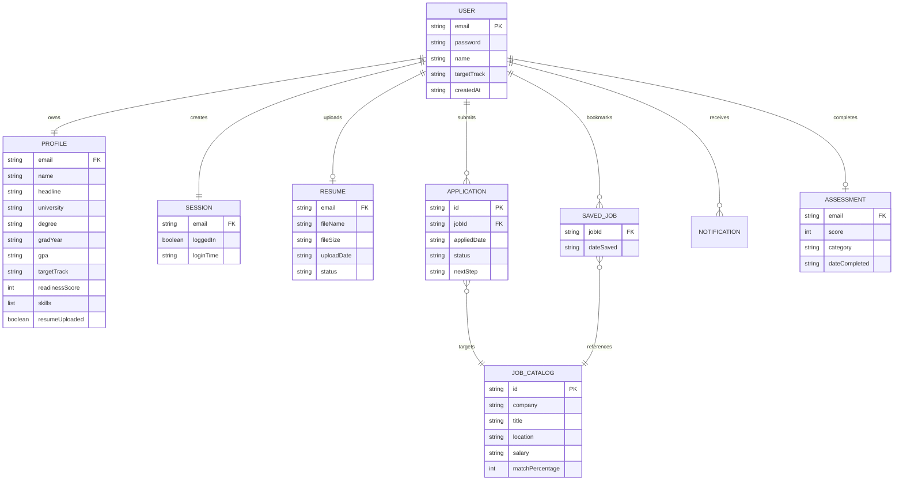

# NEXORA Comprehensive Database and Data Persistence Architecture

## 1. Executive Storage Overview

NEXORA utilizes a **Client-Side Serverless Persistence Architecture** built directly upon the standardized HTML5 Web Storage API (`window.localStorage`). This architecture allows the platform to function with zero external server dependencies, immediate offline capability, sub-millisecond read/write access times, and complete data privacy by keeping candidate information within the client's browser boundary.

All platform entities are serialized as JSON objects and managed through the centralized singleton controller [`assets/js/portal.js`](file:///C:/Users/Admin/.gemini/antigravity/scratch/career-guidance-platform/assets/js/portal.js) and authentication manager [`assets/js/auth.js`](file:///C:/Users/Admin/.gemini/antigravity/scratch/career-guidance-platform/assets/js/auth.js).

---

## 2. LocalStorage Entity Schemas

### 2.1. Candidate Profile Entity (`nexora-profile`)
- **Key:** `nexora-profile`
- **Type:** JSON Object
- **Purpose:** Stores comprehensive personal, academic, and professional information for the authenticated candidate.

```json
{
  "name": "Elena Rostova",
  "firstName": "Elena",
  "lastName": "Rostova",
  "email": "elena.rostova@ai-quantum.org",
  "headline": "B.S. Computer Science & Engineering '26",
  "university": "Stanford University",
  "degree": "Computer Science & Engineering",
  "gradYear": "2026",
  "gpa": "3.88 / 4.0",
  "targetTrack": "AI & Machine Learning",
  "avatar": "data:image/svg+xml;utf8,...",
  "readinessScore": 92,
  "skills": [
    "Python",
    "PyTorch",
    "Machine Learning",
    "TensorFlow",
    "Deep Learning",
    "Linear Algebra",
    "NumPy",
    "Pandas"
  ],
  "resumeUploaded": true
}
```

#### Field Specifications:
| Field | Data Type | Nullable | Default Value | Description & Constraints |
| :--- | :--- | :--- | :--- | :--- |
| `name` | String | No | "Alex Rivera" | Candidate full legal name (Max 80 chars) |
| `firstName` | String | No | "Alex" | Candidate given name used for UI greetings |
| `lastName` | String | Yes | "" | Candidate family name |
| `email` | String | No | "candidate@nexora.io" | Valid RFC 5322 email string |
| `headline` | String | No | "B.S. CS '26" | Professional headline / academic badge |
| `university` | String | Yes | "Stanford University" | Academic institution name |
| `degree` | String | Yes | "Computer Science" | Degree program title |
| `gradYear` | String | Yes | "2026" | Anticipated or actual graduation year |
| `gpa` | String | Yes | "3.82 / 4.0" | Academic grade point average string |
| `targetTrack` | String | No | "Software Engineering"| Target career discipline track |
| `avatar` | String | No | SVG Data URI | Profile picture URL or generated SVG |
| `readinessScore`| Number | No | 78 | Composite career readiness percentage (0-100) |
| `skills` | Array\<String\>| No | `[]` | List of verified candidate competencies |
| `resumeUploaded`| Boolean| No | `false` | Status flag indicating active CV presence |

---

### 2.2. Session State Entity (`nexora-session`)
- **Key:** `nexora-session`
- **Type:** JSON Object
- **Purpose:** Maintains client authentication state, current login session, and session timestamp.

```json
{
  "loggedIn": true,
  "email": "elena.rostova@ai-quantum.org",
  "name": "Elena Rostova",
  "loginTime": "2026-11-02T15:50:00.000Z"
}
```

---

### 2.3. User Credentials Registry Entity (`nexora-user`)
- **Key:** `nexora-user`
- **Type:** JSON Object
- **Purpose:** Local mock account credential store for verifying login attempts.

```json
{
  "name": "Elena Rostova",
  "email": "elena.rostova@ai-quantum.org",
  "password": "Quantum2026!Sec",
  "targetTrack": "AI & Machine Learning",
  "createdAt": "2026-11-02T15:50:00.000Z"
}
```

---

### 2.4. Uploaded Resume Metadata Entity (`nexora-resume`)
- **Key:** `nexora-resume`
- **Type:** JSON Object
- **Purpose:** Tracks candidate active uploaded resume metadata without bloating `localStorage` with raw binary data.

```json
{
  "fileName": "Elena_Rostova_AI_Resume.pdf",
  "fileSize": "1.42 MB",
  "uploadDate": "Nov 2, 2026",
  "status": "Verified Active",
  "extractedKeywords": ["PyTorch", "Transformers", "Distributed Systems", "CUDA"]
}
```

---

### 2.5. Saved Jobs Entity (`nexora-saved-jobs`)
- **Key:** `nexora-saved-jobs`
- **Type:** JSON Array of Objects
- **Purpose:** Candidate bookmarked vacancies.

```json
[
  {
    "id": "nv-dl-eng",
    "company": "NVIDIA",
    "companyLogo": "assets/logos/nvidia.svg",
    "badgeClass": "badge-nvidia",
    "jobTitle": "Deep Learning Software Engineer",
    "location": "Bengaluru / Santa Clara (Hybrid)",
    "salary": "$165,000 - $210,000",
    "matchPercentage": 98,
    "workMode": "Hybrid",
    "dateSaved": "Nov 2, 2026"
  }
]
```

---

### 2.6. Job Applications Pipeline Entity (`nexora-applications`)
- **Key:** `nexora-applications`
- **Type:** JSON Array of Objects
- **Purpose:** Multi-stage job application pipeline tracking (Kanban workflow).

```json
[
  {
    "id": "app-101",
    "company": "Google",
    "companyLogo": "assets/logos/google.svg",
    "badgeClass": "badge-google",
    "jobTitle": "Software Engineer III - Cloud",
    "location": "Bengaluru, India",
    "appliedDate": "Oct 28, 2026",
    "status": "Interview",
    "statusClass": "badge-blue",
    "nextStep": "System Design Round scheduled for Nov 10, 2026"
  },
  {
    "id": "app-102",
    "company": "Microsoft",
    "companyLogo": "assets/logos/microsoft.svg",
    "badgeClass": "badge-microsoft",
    "jobTitle": "AI Research Scientist",
    "location": "Redmond, WA (Hybrid)",
    "appliedDate": "Oct 15, 2026",
    "status": "Selected",
    "statusClass": "badge-emerald",
    "nextStep": "Offer letter received. Compensation review in progress."
  }
]
```

---

### 2.7. Skill Assessment Results Entity (`nexora-assessment`)
- **Key:** `nexora-assessment`
- **Type:** JSON Object
- **Purpose:** Assessment score history, domain percentages, strengths, and recommended improvements.

```json
{
  "score": 92,
  "category": "Expert Advanced",
  "dateCompleted": "Nov 2, 2026",
  "domainBreakdown": {
    "algorithms": 95,
    "systemArchitecture": 90,
    "codeQuality": 92,
    "problemSolving": 88
  },
  "strengths": ["Deep Neural Networks", "Computational Complexity", "Graph Algorithms"],
  "improvements": ["Distributed Tracing", "Kubernetes Operator Patterns"]
}
```

---

### 2.8. Notification Center Entity (`nexora-notifications`)
- **Key:** `nexora-notifications`
- **Type:** JSON Array of Objects
- **Purpose:** System alerts, interview notifications, and new match announcements.

```json
[
  {
    "id": "notif-101",
    "type": "job",
    "title": "98% Fit Match: Senior AI Researcher at Meta AI Labs",
    "time": "15 minutes ago",
    "read": false,
    "link": "job-matches.html"
  },
  {
    "id": "notif-102",
    "type": "interview",
    "title": "Google interview reminder: Technical Round 2 in 48 hours",
    "time": "3 hours ago",
    "read": false,
    "link": "applications.html"
  }
]
```

---

### 2.9. Theme Preference Entity (`nexora-theme`)
- **Key:** `nexora-theme`
- **Type:** String
- **Value:** `"dark"` | `"light"`
- **Default:** `"dark"`

---

## 3. Entity-Relationship Diagram (ERD)



---

## 4. In-Memory Static Data Catalogs

### 4.1. Jobs Repository (`NEXORA_JOBS`)
Located in [`assets/js/jobs-data.js`](file:///C:/Users/Admin/.gemini/antigravity/scratch/career-guidance-platform/assets/js/jobs-data.js), this structured catalog provides 12 enterprise vacancies with complete metadata:
- **Keys:** `id`, `company`, `companyLogo`, `badgeClass`, `jobTitle`, `location`, `salary`, `salaryMin`, `salaryMax`, `workMode`, `jobType`, `experience`, `matchPercentage`, `description`, `responsibilities`, `requirements`, `benefits`, `postedDate`, `deadline`.
- **Companies Featured:** Google, NVIDIA, Microsoft, Apple, Amazon, Meta, Atlassian, Adobe, Salesforce, Cisco, Goldman Sachs, Uber.

### 4.2. Assessment Question Bank
Located in [`assets/js/assessment.js`](file:///C:/Users/Admin/.gemini/antigravity/scratch/career-guidance-platform/assets/js/assessment.js):
- 15 questions categorized across **Algorithms & Data Structures**, **System Architecture & Cloud**, **Database Design & Optimization**, and **Problem Solving**.
- Point weight: 6.67 points per question (Total 100 points maximum).

---

## 5. CRUD Operations Reference

| Entity | Create Method | Read Method | Update Method | Delete Method |
| :--- | :--- | :--- | :--- | :--- |
| **Profile** | `NEXORAAuth.register()` | `NEXORAPortal.getProfile()` | `NEXORAPortal.saveProfile()` | Reset via `settings.js` |
| **Session** | `NEXORAAuth.login()` | `NEXORAAuth.getCurrentUser()`| Handled by session guard | `NEXORAAuth.logout()` |
| **Resume** | Handled in `profile.js` | `NEXORAPortal.getResumeData()`| Replace in `profile.js` | Remove via file input |
| **Saved Jobs** | `NEXORAPortal.toggleSaveJob()`| `NEXORAPortal.getSavedJobs()` | Dynamic re-ranking | `toggleSaveJob()` uncheck |
| **Applications** | `NEXORAPortal.applyForJob()` | `NEXORAPortal.getApplications()` | `updateApplicationStatus()` | Remove application |
| **Notifications**| System broadcast | `NEXORAPortal.getNotifications()`| `markNotificationRead()` | `clearAllNotifications()` |
| **Assessment** | Submitted via quiz | `getAssessmentResults()` | Overwritten upon retake | Reset assessment |

---

## 6. LocalStorage Constraints & Quota Strategy

1. **Storage Quota:** Standard browser `localStorage` allocates 5MB to 10MB per origin.
2. **NEXORA Footprint Analysis:**
   - Active user profile: ~1.5 KB
   - Saved jobs & applications: ~4.0 KB
   - Notifications: ~1.2 KB
   - Assessment history: ~0.8 KB
   - **Total Active Usage:** ~7.5 KB (< 0.15% of browser quota).
3. **Binary Data Protection:** Binary resume files (PDF/DOCX) are intentionally **NOT** stored as Base64 strings in `localStorage` to avoid exceeding storage quotas. Only lightweight file metadata (`fileName`, `fileSize`, `uploadDate`, `status`) is persisted in `nexora-resume`.

---

## 7. Enterprise Production Database Migration Plan (Phase 2)

### 7.1. Relational PostgreSQL Schema (DDL)

```sql
-- Phase 2 Production Relational Schema
CREATE TABLE users (
    id UUID PRIMARY KEY DEFAULT gen_random_uuid(),
    email VARCHAR(255) UNIQUE NOT NULL,
    password_hash VARCHAR(255) NOT NULL,
    full_name VARCHAR(150) NOT NULL,
    target_track VARCHAR(100) NOT NULL,
    created_at TIMESTAMP WITH TIME ZONE DEFAULT CURRENT_TIMESTAMP,
    updated_at TIMESTAMP WITH TIME ZONE DEFAULT CURRENT_TIMESTAMP
);

CREATE TABLE profiles (
    user_id UUID PRIMARY KEY REFERENCES users(id) ON DELETE CASCADE,
    headline VARCHAR(255),
    university VARCHAR(255),
    degree VARCHAR(150),
    graduation_year VARCHAR(10),
    gpa VARCHAR(20),
    readiness_score INTEGER DEFAULT 0 CHECK (readiness_score BETWEEN 0 AND 100),
    skills TEXT[] DEFAULT '{}',
    avatar_url TEXT,
    resume_uploaded BOOLEAN DEFAULT FALSE
);

CREATE TABLE resumes (
    id UUID PRIMARY KEY DEFAULT gen_random_uuid(),
    user_id UUID REFERENCES users(id) ON DELETE CASCADE,
    file_name VARCHAR(255) NOT NULL,
    file_size_bytes BIGINT NOT NULL,
    s3_storage_key TEXT NOT NULL,
    verified BOOLEAN DEFAULT FALSE,
    uploaded_at TIMESTAMP WITH TIME ZONE DEFAULT CURRENT_TIMESTAMP
);

CREATE TABLE jobs (
    id VARCHAR(50) PRIMARY KEY,
    company VARCHAR(100) NOT NULL,
    title VARCHAR(150) NOT NULL,
    location VARCHAR(150) NOT NULL,
    salary_range VARCHAR(100) NOT NULL,
    salary_min INTEGER NOT NULL,
    salary_max INTEGER NOT NULL,
    work_mode VARCHAR(50) NOT NULL,
    experience_level VARCHAR(50) NOT NULL,
    description TEXT NOT NULL,
    requirements TEXT[] NOT NULL
);

CREATE TABLE job_applications (
    id UUID PRIMARY KEY DEFAULT gen_random_uuid(),
    user_id UUID REFERENCES users(id) ON DELETE CASCADE,
    job_id VARCHAR(50) REFERENCES jobs(id) ON DELETE RESTRICT,
    status VARCHAR(50) DEFAULT 'Applied' CHECK (status IN ('Applied', 'Under Review', 'Interview', 'Selected', 'Rejected')),
    applied_at TIMESTAMP WITH TIME ZONE DEFAULT CURRENT_TIMESTAMP,
    next_step_details TEXT
);
```
