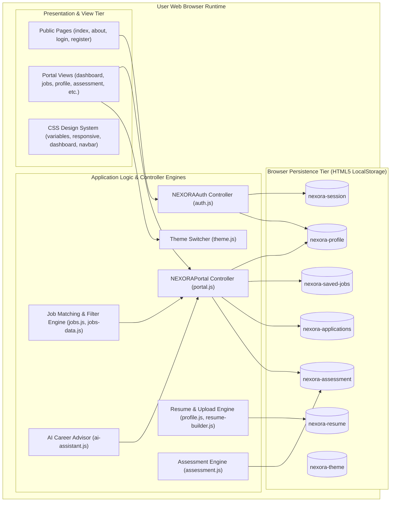
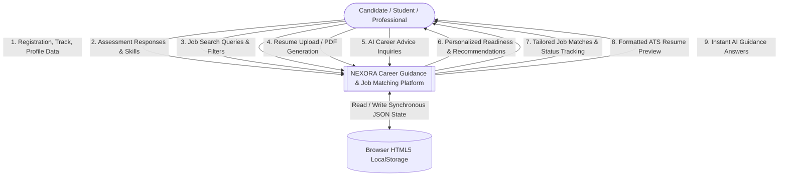
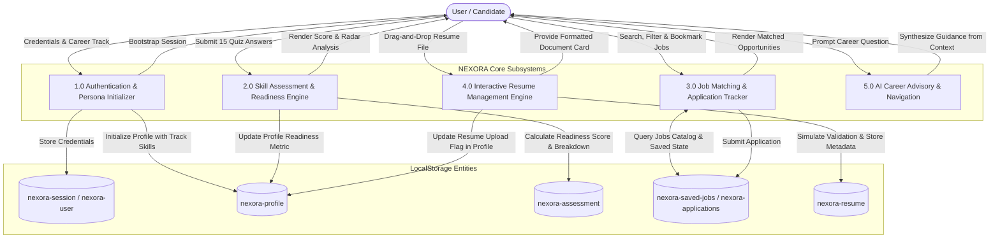
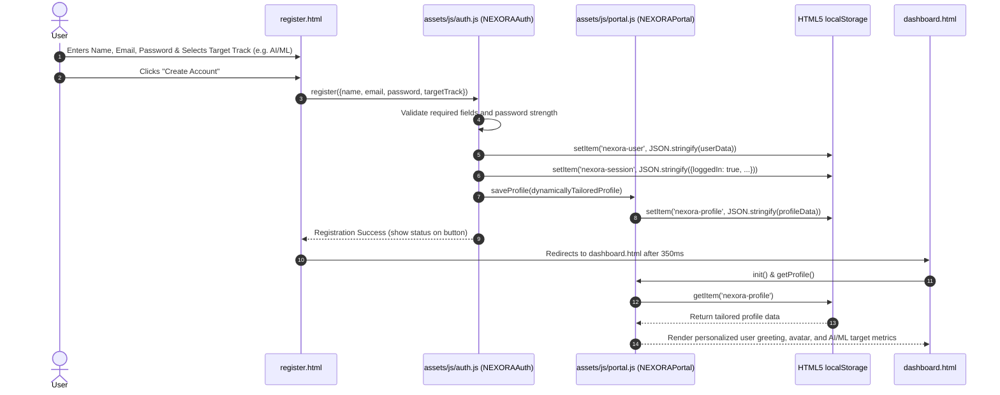
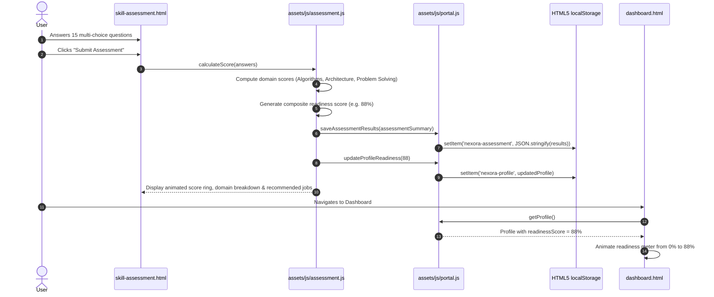
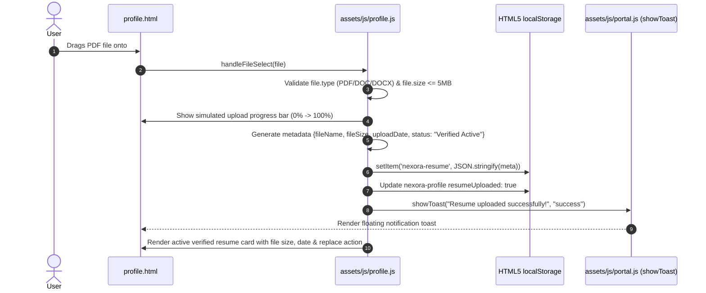
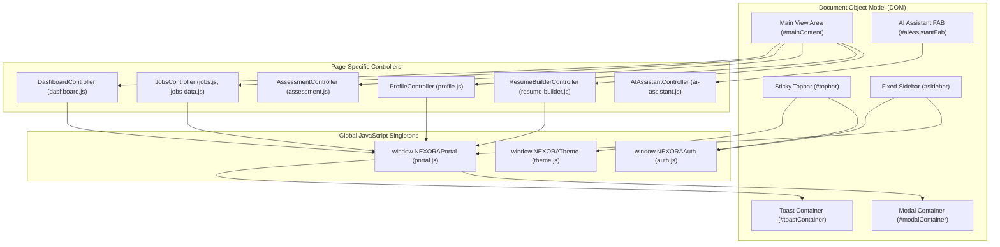
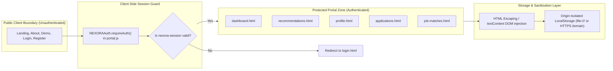

# NEXORA System Architecture and Technical Design Documentation

## 1. Executive Architectural Summary

NEXORA is an advanced, client-side, serverless Career Intelligence and Job Matching Platform designed as a modern hybrid Single-Page / Multi-Page Application (SPA/MPA). Built strictly with vanilla web technologies (HTML5, modern CSS3 with custom variables, and ECMAScript 2022+ JavaScript), the application delivers enterprise-grade responsiveness, zero third-party framework dependencies, lightning-fast execution, and seamless client-side state persistence via the HTML5 Web Storage API (`localStorage`).

```
========================================================================================
                          NEXORA HIGH-LEVEL ARCHITECTURAL STACK
========================================================================================
[Client Presentation Layer]   --> 20 Semantic HTML5 Pages + 10 Modular CSS3 Design Systems
[Component & Event Engine]     --> DOM Event Listeners, Mutation Observers, Viewport Adapters
[Business Logic Engines]      --> 17 Modular JavaScript Controllers (window.NEXORAPortal / Auth)
[Data Persistence Tier]       --> LocalStorage (JSON-Serialized Schemas) + Static Catalogs
========================================================================================
```

---

## 2. Architectural Layers

### 2.1. Presentation Layer (View Tier)
The presentation layer consists of 20 distinct HTML5 views categorized into two primary security and operational zones:
1. **Public Marketing & Authentication Zone:**
   - [`index.html`](file:///C:/Users/Admin/.gemini/antigravity/scratch/career-guidance-platform/index.html): Public hero landing page, statistics, feature showcases, testimonials, interactive preview.
   - [`about.html`](file:///C:/Users/Admin/.gemini/antigravity/scratch/career-guidance-platform/about.html): Platform mission, core architectural differentiators, leadership vision, methodology.
   - [`login.html`](file:///C:/Users/Admin/.gemini/antigravity/scratch/career-guidance-platform/login.html): User authentication entry point with credential validation and session bootstrap.
   - [`register.html`](file:///C:/Users/Admin/.gemini/antigravity/scratch/career-guidance-platform/register.html): Dynamic account creation with specialized career track personalization.
   - [`career-details.html`](file:///C:/Users/Admin/.gemini/antigravity/scratch/career-guidance-platform/career-details.html): Deep-dive career profile page with market benchmarks.
   - [`job-details.html`](file:///C:/Users/Admin/.gemini/antigravity/scratch/career-guidance-platform/job-details.html): Comprehensive job vacancy breakdown, requirements, and apply CTA.
   - [`assessment-demo.html`](file:///C:/Users/Admin/.gemini/antigravity/scratch/career-guidance-platform/assessment-demo.html): Public interactive quiz demonstration preview.

2. **Authenticated Student/Professional Portal Zone:**
   - [`dashboard.html`](file:///C:/Users/Admin/.gemini/antigravity/scratch/career-guidance-platform/dashboard.html): Central command hub with career readiness gauge, quick actions, recommended roles, and activity feed.
   - [`recommendations.html`](file:///C:/Users/Admin/.gemini/antigravity/scratch/career-guidance-platform/recommendations.html): AI-driven match matrices tailored to candidate skills and track.
   - [`career-explorer.html`](file:///C:/Users/Admin/.gemini/antigravity/scratch/career-guidance-platform/career-explorer.html): Interactive catalog of 12 technology disciplines with salary benchmarks and prerequisites.
   - [`job-matches.html`](file:///C:/Users/Admin/.gemini/antigravity/scratch/career-guidance-platform/job-matches.html): Filterable job portal with salary range, work type, location, and match percentages.
   - [`skill-assessment.html`](file:///C:/Users/Admin/.gemini/antigravity/scratch/career-guidance-platform/skill-assessment.html): 15-question multi-domain assessment engine with live readiness score computation.
   - [`learning-roadmap.html`](file:///C:/Users/Admin/.gemini/antigravity/scratch/career-guidance-platform/learning-roadmap.html): Milestone-based interactive progression roadmap for career specialization.
   - [`resume-builder.html`](file:///C:/Users/Admin/.gemini/antigravity/scratch/career-guidance-platform/resume-builder.html): Live WYSIWYG resume generator with ATS formatting and print optimization.
   - [`saved-jobs.html`](file:///C:/Users/Admin/.gemini/antigravity/scratch/career-guidance-platform/saved-jobs.html): Candidate bookmark management interface.
   - [`applications.html`](file:///C:/Users/Admin/.gemini/antigravity/scratch/career-guidance-platform/applications.html): Kanban-style application tracker (Applied, Review, Interview, Offer, Rejected).
   - [`notifications.html`](file:///C:/Users/Admin/.gemini/antigravity/scratch/career-guidance-platform/notifications.html): Activity notifications, assessment alerts, and application updates.
   - [`settings.html`](file:///C:/Users/Admin/.gemini/antigravity/scratch/career-guidance-platform/settings.html): User preferences, theme selection, security settings, and session termination.
   - [`profile.html`](file:///C:/Users/Admin/.gemini/antigravity/scratch/career-guidance-platform/profile.html): Candidate identity management, academic details, verified skills, and interactive resume upload engine.
   - [`ai-assistant.html`](file:///C:/Users/Admin/.gemini/antigravity/scratch/career-guidance-platform/ai-assistant.html): Full-screen conversational AI career advisor with domain knowledge retrieval.

### 2.2. Design System and Styling Layer
The visual architecture is implemented via 10 isolated CSS modules located in [`css/`](file:///C:/Users/Admin/.gemini/antigravity/scratch/career-guidance-platform/css/):
- [`variables.css`](file:///C:/Users/Admin/.gemini/antigravity/scratch/career-guidance-platform/css/variables.css): Centralized design tokens (colors, gradients, typography, shadows, borders, transitions) supporting dark and light themes via CSS custom properties (`--bg-primary`, `--accent-primary`, etc.).
- [`style.css`](file:///C:/Users/Admin/.gemini/antigravity/scratch/career-guidance-platform/css/style.css): Global reset, typography rules, root container layout constraints, and clipping policies (`overflow-x: clip`).
- [`navbar.css`](file:///C:/Users/Admin/.gemini/antigravity/scratch/career-guidance-platform/css/navbar.css): Sticky topbar navigation, continuous animated SVG logo keyframes (`nexoraBadgeAura`, `nexoraStrokePulse`, `nexoraArrowFloat`), user menu dropdowns, and mobile menu toggles.
- [`components.css`](file:///C:/Users/Admin/.gemini/antigravity/scratch/career-guidance-platform/css/components.css): Reusable UI primitives (buttons, badge tags, modal dialogs, cards, toast notifications, loaders).
- [`forms.css`](file:///C:/Users/Admin/.gemini/antigravity/scratch/career-guidance-platform/css/forms.css): Standardized input fields, select menus, checkboxes, toggle switches, and form validation error states.
- [`dashboard.css`](file:///C:/Users/Admin/.gemini/antigravity/scratch/career-guidance-platform/css/dashboard.css): Portal structural shell (`.portal-layout`), fixed desktop sidebar (`260px`), sticky topbar header (`70px`), and main content container (`.portal-content`).
- [`visuals.css`](file:///C:/Users/Admin/.gemini/antigravity/scratch/career-guidance-platform/css/visuals.css): Hero banners, high-resolution background treatments, glassmorphism cards, and company brand badge styling.
- [`responsive.css`](file:///C:/Users/Admin/.gemini/antigravity/scratch/career-guidance-platform/css/responsive.css): Multi-breakpoint media queries (from 320px small mobile to 2560px ultra-wide) ensuring zero horizontal scrollbars and fluid adaptability.
- [`animations.css`](file:///C:/Users/Admin/.gemini/antigravity/scratch/career-guidance-platform/css/animations.css): Performance-optimized micro-interactions, fade-ins, float animations, and shimmer effects.
- [`print.css`](file:///C:/Users/Admin/.gemini/antigravity/scratch/career-guidance-platform/css/print.css): High-fidelity print styles for resume printing and PDF generation, stripping UI navigation.

### 2.3. Business Logic and Controller Engines
Application behavior is decoupled into 17 focused JavaScript modules in [`assets/js/`](file:///C:/Users/Admin/.gemini/antigravity/scratch/career-guidance-platform/assets/js/):
- [`portal.js`](file:///C:/Users/Admin/.gemini/antigravity/scratch/career-guidance-platform/assets/js/portal.js): The central platform engine exposing `window.NEXORAPortal`. Governs shared state, profile hydration, saved jobs, notifications, modal management, and UI toasts.
- [`auth.js`](file:///C:/Users/Admin/.gemini/antigravity/scratch/career-guidance-platform/assets/js/auth.js): Exposes `window.NEXORAAuth`. Manages dynamic user registration, track personalization, credential validation, session initialization, and logout flows.
- [`jobs-data.js`](file:///C:/Users/Admin/.gemini/antigravity/scratch/career-guidance-platform/assets/js/jobs-data.js): Comprehensive database of 12 detailed job positions with requirements, salary, experience, and match metrics.
- [`jobs.js`](file:///C:/Users/Admin/.gemini/antigravity/scratch/career-guidance-platform/assets/js/jobs.js): Search filter controller, salary range slider binding, card rendering, and bookmark toggling.
- [`assessment.js`](file:///C:/Users/Admin/.gemini/antigravity/scratch/career-guidance-platform/assets/js/assessment.js): 15-question interactive evaluation engine with domain weights, timer, scoring algorithm, and result calculation.
- [`profile.js`](file:///C:/Users/Admin/.gemini/antigravity/scratch/career-guidance-platform/assets/js/profile.js): Profile editor, skill chip manager, and interactive drag-and-drop resume upload engine with simulated progress bar.
- [`resume-builder.js`](file:///C:/Users/Admin/.gemini/antigravity/scratch/career-guidance-platform/assets/js/resume-builder.js): Live resume editor with real-time preview, template switching, auto-fill from profile, and browser print trigger.
- [`ai-assistant.js`](file:///C:/Users/Admin/.gemini/antigravity/scratch/career-guidance-platform/assets/js/ai-assistant.js): Natural-language career advisor with intent parsing, automated responses, and floating action button (FAB) widget.
- [`saved-jobs.js`](file:///C:/Users/Admin/.gemini/antigravity/scratch/career-guidance-platform/assets/js/saved-jobs.js): Controller for managing and displaying bookmarked vacancies.
- [`applications.js`](file:///C:/Users/Admin/.gemini/antigravity/scratch/career-guidance-platform/assets/js/applications.js): Kanban-style application management, interview scheduling, and status updates.
- [`notifications.js`](file:///C:/Users/Admin/.gemini/antigravity/scratch/career-guidance-platform/assets/js/notifications.js): Notification rendering, mark as read, and badge count manager.
- [`career-explorer.js`](file:///C:/Users/Admin/.gemini/antigravity/scratch/career-guidance-platform/assets/js/career-explorer.js): Career track filter controller, search input handler, and detailed modal renderer.
- [`roadmap.js`](file:///C:/Users/Admin/.gemini/antigravity/scratch/career-guidance-platform/assets/js/roadmap.js): Learning milestone completion tracker and career milestone timeline renderer.
- [`dashboard.js`](file:///C:/Users/Admin/.gemini/antigravity/scratch/career-guidance-platform/assets/js/dashboard.js): Dashboard initialization, dynamic greeting calculation, readiness progress ring animation, and activity hydration.
- [`settings.js`](file:///C:/Users/Admin/.gemini/antigravity/scratch/career-guidance-platform/assets/js/settings.js): Account settings form handler, theme switcher integration, and storage reset utilities.
- [`theme.js`](file:///C:/Users/Admin/.gemini/antigravity/scratch/career-guidance-platform/assets/js/theme.js): Global theme manager supporting system preference detection, toggle synchronization, and persistence.
- [`public.js`](file:///C:/Users/Admin/.gemini/antigravity/scratch/career-guidance-platform/assets/js/public.js): Public navigation bar controller, mobile drawer toggle, and smooth scrolling handlers.

### 2.4. Persistence Layer (Storage Tier)
Data persistence is handled entirely on the client side using the HTML5 `window.localStorage` key-value store under isolated `nexora-*` namespaces:
- `nexora-profile`: JSON entity containing candidate information, target track, university, GPA, readiness score, and skills.
- `nexora-session`: JSON entity tracking current session status (`loggedIn`, `email`, `name`, `loginTime`).
- `nexora-user`: User authentication record for login verification.
- `nexora-resume`: Active uploaded resume metadata (`fileName`, `fileSize`, `uploadDate`, `status`).
- `nexora-saved-jobs`: Serialized array of saved job IDs and metadata.
- `nexora-applications`: Serialized array of applied jobs with stage timestamps.
- `nexora-assessment`: Assessment scoring metrics, domain breakdown, and completion status.
- `nexora-notifications`: Notification items list with read/unread flags.
- `nexora-theme`: UI theme string preference (`dark` or `light`).

---

## 3. Comprehensive System Diagrams

### 3.1. Overall System Architecture Diagram



---

### 3.2. Data Flow Diagram: DFD Level 0 (Context Level)



---

### 3.3. Data Flow Diagram: DFD Level 1 (Major Subsystems)



---

### 3.4. Data Flow Diagram: DFD Level 2 (Decomposition of Assessment & Resume Engines)

```mermaid
flowchart TD
    subgraph DFD_Assess ["2.0 Skill Assessment Decomposition"]
        A_Input["2.1 Receive Question Selection"] --> A_Weight["2.2 Apply Domain Weighting (Tech, Domain, Soft Skills)"]
        A_Weight --> A_Calc["2.3 Calculate Composite Percentage & Readiness"]
        A_Calc --> A_Track["2.4 Compare against Target Track Benchmarks"]
        A_Track --> A_Persist["2.5 Update nexora-assessment & nexora-profile"]
    end

    subgraph DFD_Resume ["4.0 Resume Engine Decomposition"]
        R_Drop["4.1 File Drop / Input Event"] --> R_Valid["4.2 MIME & Size Validation (PDF/DOCX, <= 5MB)"]
        R_Valid --> R_Sim["4.3 Simulate Progress Animation (0% -> 100%)"]
        R_Sim --> R_Meta["4.4 Extract Metadata (FileName, Size, Timestamp)"]
        R_Meta --> R_Store["4.5 Store to nexora-resume & Activate UI Card"]
    end
```



---

### 3.5. Sequence Diagram: Dynamic Registration, Personalization, and Session Bootstrap



---

### 3.6. Sequence Diagram: Skill Assessment Evaluation & Readiness Score Synchronization



---

### 3.7. Sequence Diagram: Interactive Resume Drag-and-Drop Upload



---

### 3.8. Component Architecture Diagram



---

### 3.9. Security and Isolation Architecture



---

## 4. Key Architectural Decisions (ADRs)

### ADR-01: Frameworkless Vanilla Architecture
- **Decision:** Build entirely with standards-compliant HTML5, modular CSS3, and modern ES6+ JavaScript without React, Angular, Vue, or build tooling (e.g., Webpack/Vite).
- **Rationale:** Delivers zero compilation overhead, instant zero-latency loading in any web browser, zero dependency vulnerabilities, perfect portability across environments (file system, local web servers, GitHub Pages, Vercel), and pristine transparency.

### ADR-02: Isolated LocalStorage Persistence Model
- **Decision:** Use namespaced JSON entities in browser `localStorage` as the authoritative persistence engine for the client prototype.
- **Rationale:** Enables fully functional, offline-capable candidate workflows (registration, track customization, assessment scoring, resume management, and job saving) without requiring an immediate database deployment during the prototype and testing phases.

### ADR-03: Layout Stability via CSS Overflow Clipping
- **Decision:** Enforce `overflow-x: clip` on `html` and `body` with explicit fixed desktop positioning (`position: fixed; width: 260px;`) for the portal sidebar and sticky positioning (`position: sticky; top: 0; z-index: 1000;`) for the topbar.
- **Rationale:** Completely eliminates horizontal page jumping, ensures content never scrolls behind or pushes the sidebar, and guarantees rock-solid UI stability across all 17 tested responsive viewports.
