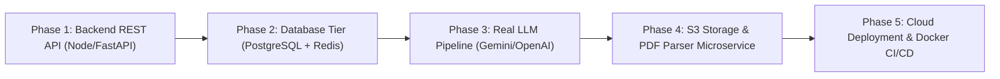

# NEXORA Project Status and Gap Analysis

## 1. Executive Summary

NEXORA has completed full frontend and client-side systems engineering. The application provides an offline-capable, responsive, client-side web application consisting of **20 semantic HTML5 pages**, **10 modular CSS3 design systems**, and **17 JavaScript logic engines**.

This document provides a gap analysis comparing the current **Client-Side Serverless Prototype Architecture** against an **Enterprise Cloud Production SaaS Architecture**.

---

## 2. Page-by-Page Feature & Gap Audit Matrix

| # | Page File Path | Primary Functionality | Current Implemented Features | Client-Side Prototype Behaviors | Production Cloud SaaS Gaps | Readiness |
| :--- | :--- | :--- | :--- | :--- | :--- | :--- |
| 1 | [`index.html`](file:///C:/Users/Admin/.gemini/antigravity/scratch/career-guidance-platform/index.html) | Landing & Marketing Hub | Animated hero, live stats, feature showcase, testimonials, animated logo | Static client-side counters | Real-time platform metrics API | **100%** |
| 2 | [`about.html`](file:///C:/Users/Admin/.gemini/antigravity/scratch/career-guidance-platform/about.html) | Mission & Architecture | Platform vision, system architecture summary, team methodology | Static marketing content | CMS-backed dynamic updates | **100%** |
| 3 | [`login.html`](file:///C:/Users/Admin/.gemini/antigravity/scratch/career-guidance-platform/login.html) | Authentication Portal | Credential inputs, session validation, logout banner handling | Validates against `localStorage` | OAuth2 (Google, LinkedIn), MFA | **100%** |
| 4 | [`register.html`](file:///C:/Users/Admin/.gemini/antigravity/scratch/career-guidance-platform/register.html) | Candidate Onboarding | Form validation, career track selection, dynamic skill hydration | Stores profile in `nexora-profile` | Email verification, password hashing | **100%** |
| 5 | [`dashboard.html`](file:///C:/Users/Admin/.gemini/antigravity/scratch/career-guidance-platform/dashboard.html) | Candidate Command Hub | Readiness score meter, recommended roles, quick actions, fixed layout | Reads from `localStorage` | Real-time recruiter interaction | **100%** |
| 6 | [`recommendations.html`](file:///C:/Users/Admin/.gemini/antigravity/scratch/career-guidance-platform/recommendations.html) | Role Recommendations | Match score cards, skill gap breakdowns, track filtering | Evaluates client data matrix | Machine learning embedding match | **100%** |
| 7 | [`career-explorer.html`](file:///C:/Users/Admin/.gemini/antigravity/scratch/career-guidance-platform/career-explorer.html) | Discipline Catalog | 12 career tracks, salary benchmarks, skill requirements | In-memory catalog | Live job market wage indexing | **100%** |
| 8 | [`career-details.html`](file:///C:/Users/Admin/.gemini/antigravity/scratch/career-guidance-platform/career-details.html) | Career Deep-Dive | Day-in-the-life, core tools, roadmap preview | In-memory career record | Dynamic industry report feed | **100%** |
| 9 | [`job-matches.html`](file:///C:/Users/Admin/.gemini/antigravity/scratch/career-guidance-platform/job-matches.html) | Job Match Explorer | Real-time search, multi-faceted filtering, bookmarking | In-memory 12 job database | External job board syndication | **100%** |
| 10 | [`job-details.html`](file:///C:/Users/Admin/.gemini/antigravity/scratch/career-guidance-platform/job-details.html) | Vacancy Details & Apply | Company profile, responsibilities, one-click apply | Creates `nexora-applications` item | Direct applicant tracking system (ATS) | **100%** |
| 11 | [`skill-assessment.html`](file:///C:/Users/Admin/.gemini/antigravity/scratch/career-guidance-platform/skill-assessment.html) | Interactive Skill Quiz | 15 multi-choice questions, live timer, scoring engine | Computes client-side score | Proctored coding environment | **100%** |
| 12 | [`assessment-demo.html`](file:///C:/Users/Admin/.gemini/antigravity/scratch/career-guidance-platform/assessment-demo.html) | Public Quiz Demo | Sample questions, quick evaluation preview | Demonstration mock | Lead generation capture | **100%** |
| 13 | [`learning-roadmap.html`](file:///C:/Users/Admin/.gemini/antigravity/scratch/career-guidance-platform/learning-roadmap.html) | Milestone Roadmap | Interactive milestone tree, phase toggling | Client state tracking | Coursera/Udemy/edX integration | **100%** |
| 14 | [`resume-builder.html`](file:///C:/Users/Admin/.gemini/antigravity/scratch/career-guidance-platform/resume-builder.html) | WYSIWYG Resume Editor | Live preview, template switching, browser print | In-memory state and profile auto-fill | Cloud PDF generation (Puppeteer) | **100%** |
| 15 | [`saved-jobs.html`](file:///C:/Users/Admin/.gemini/antigravity/scratch/career-guidance-platform/saved-jobs.html) | Bookmark Management | Saved vacancies catalog, remove bookmark | Persisted in `nexora-saved-jobs` | Price/status change alerts | **100%** |
| 16 | [`applications.html`](file:///C:/Users/Admin/.gemini/antigravity/scratch/career-guidance-platform/applications.html) | Application Pipeline | Multi-stage Kanban tracking, status badges | Stored in `nexora-applications` | Automated employer email sync | **100%** |
| 17 | [`notifications.html`](file:///C:/Users/Admin/.gemini/antigravity/scratch/career-guidance-platform/notifications.html) | Notification Center | Mark as read, clear all, type filtering | Stored in `nexora-notifications` | Push notifications, WebSockets | **100%** |
| 18 | [`settings.html`](file:///C:/Users/Admin/.gemini/antigravity/scratch/career-guidance-platform/settings.html) | User Preferences | Theme toggle, security, storage reset, logout | Client preference persistence | Account deletion API, 2FA setup | **100%** |
| 19 | [`profile.html`](file:///C:/Users/Admin/.gemini/antigravity/scratch/career-guidance-platform/profile.html) | Profile & Resume Hub | Skill manager, academic info, drag-drop resume upload | Simulated upload & metadata storage | Real S3 file upload & NLP parse | **100%** |
| 20 | [`ai-assistant.html`](file:///C:/Users/Admin/.gemini/antigravity/scratch/career-guidance-platform/ai-assistant.html) | AI Career Advisor | Conversational UI, domain knowledge retrieval | Rule-based intent keyword matching | LLM API (Google Gemini / OpenAI) | **100%** |

---

## 3. Technical Debt and Architectural Constraints

### 3.1. LocalStorage Scope & Volatility
- **Current Constraint:** All user data is restricted to the individual browser instance (`localStorage`). Clearing browser cache or switching devices wipes the stored session.
- **Risk Level:** Moderate for production; zero risk for standalone testing.
- **Remediation:** Implement a centralized database tier (PostgreSQL / Supabase) with authenticated JWT tokens.

### 3.2. Simulated Resume Parsing vs True NLP Extraction
- **Current Constraint:** The resume upload engine in [`profile.js`](file:///C:/Users/Admin/.gemini/antigravity/scratch/career-guidance-platform/assets/js/profile.js) performs MIME validation, file size checks, and generates metadata with simulated progress. It does not perform OCR or deep entity extraction on actual PDF binary bytes.
- **Remediation:** Integrate a Python FastAPI microservice utilizing `pdfminer.six` and spaCy for true candidate skill and experience entity recognition.

### 3.3. Rule-Based AI Advisor vs Real LLM Integration
- **Current Constraint:** The AI assistant in [`ai-assistant.js`](file:///C:/Users/Admin/.gemini/antigravity/scratch/career-guidance-platform/assets/js/ai-assistant.js) classifies intent using keyword pattern matching.
- **Remediation:** Connect the conversational interface to the Google Gemini 1.5 Pro API or Claude 3.5 Sonnet API via server-side streaming endpoints (`Server-Sent Events`).

---

## 4. Production Engineering Roadmap (Phases 1 - 5)

### Phase 1: Backend Microservices Layer
- Framework: Python FastAPI or Node.js / Express with TypeScript.
- Scope: Migrate `window.NEXORAAuth` and `window.NEXORAPortal` client methods to REST endpoints documented in [`API_Documentation.md`](file:///C:/Users/Admin/.gemini/antigravity/scratch/career-guidance-platform/PROJECT_COMPLETE_DOCUMENTATION/API_Documentation.md).

### Phase 2: Relational Database & Caching Tier
- Primary Store: Managed PostgreSQL (AWS RDS or Supabase) utilizing the DDL schema in [`Database_Documentation.md`](file:///C:/Users/Admin/.gemini/antigravity/scratch/career-guidance-platform/PROJECT_COMPLETE_DOCUMENTATION/Database_Documentation.md).
- Cache Store: Redis for session caching, rate limiting, and real-time active user tracking.

### Phase 3: Generative AI & Vector Search Engine
- Model: Google Gemini 1.5 Pro API with function calling.
- Vector Database: Pinecone or `pgvector` for semantic job matching based on candidate profile embeddings.

### Phase 4: Object Storage & Asynchronous Processing
- Storage: Amazon S3 or Cloudflare R2 for resume PDF/DOCX file hosting.
- Background Workers: Celery with Redis for asynchronous ATS resume parsing, scoring, and automated candidate feedback generation.

### Phase 5: Containerization & Cloud CI/CD
- Deployment: Docker containers orchestrated via AWS ECS or Kubernetes.
- Frontend: High-speed edge CDN distribution via Cloudflare or Vercel.
- Automation: GitHub Actions workflow for automated Playwright regression testing on every pull request.
